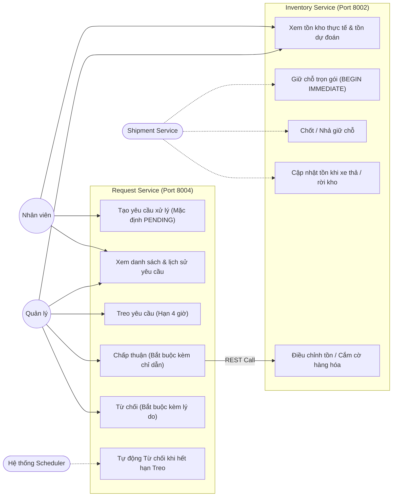
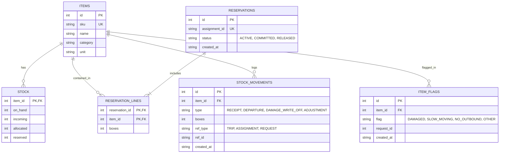
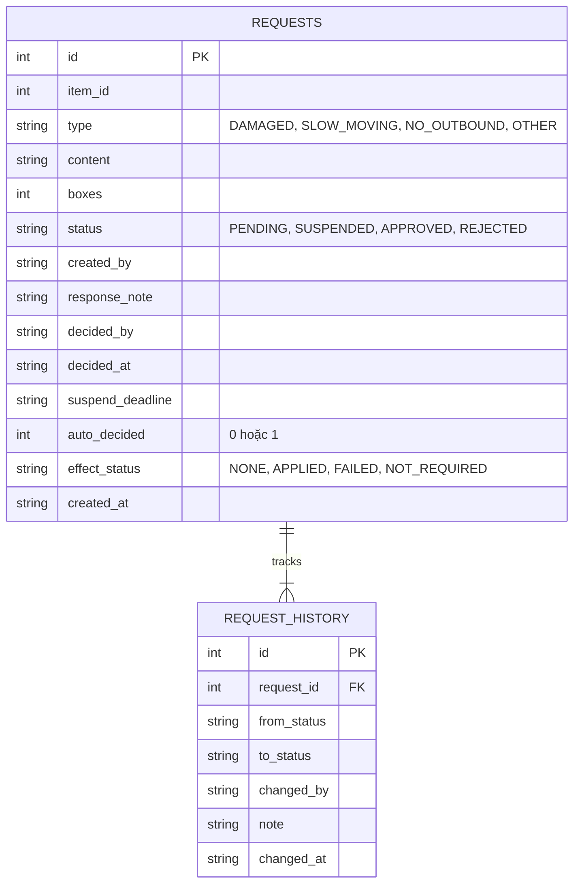

# BÁO CÁO NGHIỆP VỤ PHÂN HỆ TỒN KHO & YÊU CẦU XỬ LÝ (INVENTORY & REQUEST SERVICES)
**Môn học:** Kiến Trúc Hướng Dịch Vụ (SOA - Mã môn: 504070) - HK1/2026-2027  

**Phân hệ phụ trách:** 
1. **Inventory Service (Dịch vụ Tồn kho)**: Port 8002 | CSDL: `inventory.db`
2. **Request Service (Dịch vụ Yêu cầu xử lý)**: Port 8004 | CSDL: `request.db`
3. **Frontend Dashboard**: Giao diện Quản lý Tồn kho & Quản lý Yêu cầu xử lý (4 trạng thái)

---

## 1. TỔNG QUAN VÀ BÁM SÁT ĐỀ BÀI

### 1.1. Nghiệp vụ của Hiệu
- **Nghiệp vụ 2 (Quản lý hàng tồn trong kho)**: Tính toán tồn thực tế, tồn dự đoán, hàng trên xe chưa thả, hàng đã gán cho xe chưa rời kho, cơ chế giữ chỗ trọn gói chống tranh chấp hàng hóa khi Shipment gán hàng, và cập nhật tồn tức thì khi xe nhập/xuất kho.
- **Nghiệp vụ 4 (Quản lý yêu cầu xử lý)**: Vòng đời 4 trạng thái yêu cầu xử lý từ nhân viên (`Chờ xử lý` ➔ `Treo 4 giờ` ➔ `Chấp thuận` / `Từ chối`), quy tắc kiểm soát thời hạn của trạng thái Treo, scheduler nền tự động từ chối khi quá hạn 4 giờ, và giao tiếp liên service REST sang Inventory khi Chấp thuận.

---

## 2. BIỂU ĐỒ USE CASE & TÁC NHÂN (ACTORS)

### 2.1. Các tác nhân liên quan:
1. **Nhân viên kho (Staff)**:
   - Tra cứu danh mục và tình hình tồn kho thực tế, tồn dự đoán, khả dụng.
   - Tạo yêu cầu xử lý đối với các mặt hàng có vấn đề (Hỏng hóc, Hàng tồn quá lâu, Không có lượt xuất kho, Khác).
   - Theo dõi tiến độ và phản hồi/chỉ dẫn từ Quản lý kho.
2. **Quản lý kho (Manager)**:
   - Tra cứu toàn diện tồn kho, lịch sử biến động nhập/xuất và cờ cảnh báo.
   - Tiếp nhận và xử lý các yêu cầu xử lý: Tạm treo (hạn 4 giờ), Chấp thuận (bắt buộc kèm chỉ dẫn, tác động trừ tồn), Từ chối (bắt buộc kèm lý do).
3. **Shipment Service (Dịch vụ Xe & Lần gán - Hệ thống gọi nội bộ)**:
   - Gọi `POST /internal/reservations` để giữ chỗ hàng trọn gói cho lần gán.
   - Gọi `POST /internal/reservations/{assignment_id}/commit` khi lần gán được xác nhận hoặc tự duyệt.
   - Gọi `POST /internal/reservations/{assignment_id}/release` khi lần gán bị từ chối hoặc bị rút.
   - Gọi `POST /internal/receipts` khi xe hoàn thành thả hàng (Đang thả hàng ➔ Đang trống).
   - Gọi `POST /internal/departures` khi xe chuyển sang Đã rời kho.
4. **Hệ thống chạy ngầm (System Scheduler - APScheduler)**:
   - Quét định kỳ các yêu cầu đang Treo quá 4 giờ để tự động Từ chối với lý do mặc định.

### 2.2. Sơ đồ Use Case:


---

## 3. THIẾT KẾ CƠ SỞ DỮ LIỆU (ERD) TỪNG SERVICE

Tuân thủ nghiêm ngặt nguyên tắc microservices: **Mỗi service sở hữu một CSDL SQLite riêng, không chia sẻ file CSDL, tham chiếu chéo chỉ bằng ID logic qua REST**.

### 3.1. CSDL Inventory Service (`inventory.db`)


### 3.2. CSDL Request Service (`request.db`)


---

## 4. CHI TIẾT CÁC QUY TẮC NGHIỆP VỤ CỐT LÕI

### 4.1. Công thức Tồn kho (Nghiệp vụ 2)
1. **Tồn dự đoán (Projected Stock)**:
   $$\text{Tồn dự đoán} = \text{on\_hand} + \text{incoming} - \text{allocated}$$
   *Ý nghĩa:* Giúp nhân viên và quản lý thấy trước lượng hàng sẽ có sau khi hoàn tất các lượt xe đã và đang đến, trừ đi các xe đã gán chuẩn bị xuất đi.
2. **Khả dụng để gán (Available Stock)**:
   $$\text{Khả dụng} = \text{on\_hand} - \text{allocated} - \text{reserved}$$
   *Ý nghĩa:* Khi gán hàng xuất kho, hệ thống **bắt buộc kiểm tra theo khả dụng của tồn thực tế**, tuyệt đối không kiểm tra theo tồn dự đoán.

### 4.2. Cơ chế Giữ chỗ nguyên tử (Atomic Reservation) & Chống Tranh Chấp
- **Transaction BEGIN IMMEDIATE:** Trong SQLite, chỉ có 1 writer tại một thời điểm. Dùng `BEGIN IMMEDIATE` biến việc kiểm tra và cập nhật nhiều dòng hàng thành một thao tác nguyên tử tuyệt đối.
- **Sắp xếp theo `item_id ASC`:** Khi nhận danh sách dòng hàng, hệ thống sort theo thứ tự khóa để tránh deadlock.
- **Trọn gói (All-or-Nothing):** Nếu dù chỉ 1 mặt hàng không đủ tồn khả dụng:
  - Hủy ngay toàn bộ giao dịch (`ROLLBACK`).
  - Trả về mã lỗi HTTP `409 Conflict` kèm danh sách chi tiết: `{ item_id, requested, available, missing }`.
- **Tính Idempotent (Chống lặp mạng):** Khi nhận lại cùng `assignment_id`:
  - Nếu đã `ACTIVE`, trả về kết quả thành công ngay mà không cộng đúp.
  - Khi chốt (`commit`) hoặc nhả (`release`), nếu đã ở trạng thái đích thì trả về thành công ngay.

### 4.3. Cập nhật tồn kho theo sự kiện xe (Nghiệp vụ 3 liên kết)
- **Xe lượt đến hoàn tất dỡ hàng (Đang thả hàng ➔ Đang trống):**
  - Giảm `incoming`, tăng ngay `on_hand`. Ghi log `RECEIPT`.
- **Xe xuất kho rời khỏi kho (Chuyển sang Đã rời kho):**
  - Giảm `allocated`, giảm ngay `on_hand`. Ghi log `DEPARTURE`.

### 4.4. Vòng đời 4 trạng thái của Yêu cầu xử lý (Nghiệp vụ 4)
- **Khởi tạo:** Mặc định luôn là `PENDING` (Chờ xử lý).
- **Treo (SUSPENDED):** Quản lý có thể chuyển sang Treo. Hệ thống tự động tính thời hạn:
  $$\text{suspend\_deadline} = \text{thời điểm hiện tại} + 4\text{ giờ}$$
  Trong thời gian này, Quản lý có thể chuyển sang Chấp thuận hoặc Từ chối bất cứ lúc nào.
- **Tự động Từ chối khi hết hạn:** Scheduler nền (APScheduler) quét định kỳ các yêu cầu Treo có `suspend_deadline <= hiện tại`. Nếu quá hạn, tự động chuyển sang `REJECTED`, ghi `response_note = "Chưa có hướng xử lý từ phía quản lý"`, đánh dấu `auto_decided = 1`, `decided_by = "SYSTEM"`.
- **Ràng buộc khi phê duyệt:**
  - Chấp thuận **bắt buộc** phải có chỉ dẫn/lý do (thiếu trả `400 Bad Request`).
  - Từ chối **bắt buộc** phải có lý do (thiếu trả `400 Bad Request`).
  - Cố gắng thay đổi trạng thái của yêu cầu đã kết thúc (APPROVED / REJECTED) sẽ bị chặn ngay bằng HTTP `409 Conflict`.
- **Tác động tồn kho khi Chấp thuận:**
  - Yêu cầu Hỏng hóc (`DAMAGED`): Gọi REST sang Inventory Service `POST /internal/adjustments` để trừ số thùng hỏng khỏi `on_hand`.
  - Các loại khác: Gọi cắm cờ theo dõi (`ITEM_FLAGS`).
  - Nếu Inventory Service bị tắt hoặc lỗi kết nối (502 / 504), yêu cầu chưa được coi là xử lý xong (`effect_status = 'FAILED'`).

---

## 5. THỐNG KÊ KẾT QUẢ ĐÃ LÀM ĐƯỢC

| Hạng mục | Chi tiết đã hoàn thành | Minh chứng / Trạng thái |
| :--- | :--- | :--- |
| **Dữ liệu Seed** | `seed/seed.json` định nghĩa 10 mặt hàng đồ bảo hành mẫu kèm tồn ban đầu khớp với lượt xe | Đã tạo và nạp tự động |
| **Inventory Service** | Đủ 100% CSDL `inventory.db`, `init.sql`, WAL mode, busy timeout, Dockerfile | Hoàn thành |
| **API Inventory** | `GET /items`, `GET /stock`, `GET /stock/:id`, `GET /stock/movements`, `GET /stock/flags` | Hoàn thành |
| **API Giữ chỗ nội bộ** | `POST /internal/reservations` (atomic, 409 khi thiếu), `commit`, `release`, `receipts`, `departures`, `adjustments` | Hoàn thành |
| **Bảo mật nội bộ** | Kiểm tra header `X-Internal-Key` chặn 403 Forbidden nếu không có quyền | Hoàn thành |
| **Request Service** | CSDL `request.db`, `init.sql`, lưu vết `request_history`, Dockerfile | Hoàn thành |
| **Vòng đời 4 trạng thái** | `PENDING` ➔ `SUSPENDED` (4h) ➔ `APPROVED` / `REJECTED`. Chặn 400 khi thiếu lý do, chặn 409 khi xung đột | Hoàn thành |
| **Scheduler hạn 4 giờ** | APScheduler quét định kỳ, tự động từ chối với lý do mặc định và gắn cờ `auto_decided = 1` | Hoàn thành |
| **Liên service REST** | Request gọi sang Inventory trừ tồn hỏng hóc hoặc cắm cờ, xử lý lỗi 502/504 | Hoàn thành |
| **Prometheus Metrics** | `stock_on_hand{category}`, `reservation_failures_total`, `requests_by_status{status}`, `requests_auto_rejected_total`, `inter_service_errors_total` | Hoàn thành |
| **Kiểm thử tự động** | **15/15 test cases** pytest bao phủ toàn bộ các luồng nghiệp vụ và ca biên | **100% PASSED** (4.07s) |
| **Frontend Tồn kho** | Thẻ KPI trực quan, bảng tồn kho tính toán công thức theo thời gian thực, nút tạo yêu cầu nhanh | Đã build Vite thành công |
| **Frontend Yêu cầu** | Bộ lọc 4 trạng thái, **đồng hồ đếm ngược thời gian thực (Countdown Timer)** cho trạng thái Treo, Modal Quản lý duyệt/từ chối/treo, Modal xem timeline lịch sử | Đã build Vite thành công |

---

## 6. HƯỚNG DẪN CHẠY THỬ NGHIỆM VÀ DEMO

### 6.1. Chạy kiểm thử tự động (pytest)
```bash
# Chạy toàn bộ 15 test cases
python -m pytest services -v
```

### 6.2. Khởi chạy các service cục bộ (độc lập)
```bash
# Cửa sổ 1: Khởi động Inventory Service (Port 8002)
uvicorn services.inventory.app.main:app --port 8002 --reload

# Cửa sổ 2: Khởi động Request Service (Port 8004)
uvicorn services.request.app.main:app --port 8004 --reload

# Cửa sổ 3: Khởi động Frontend
cd frontend
npm run dev
# Mở trình duyệt tại http://localhost:3000
```