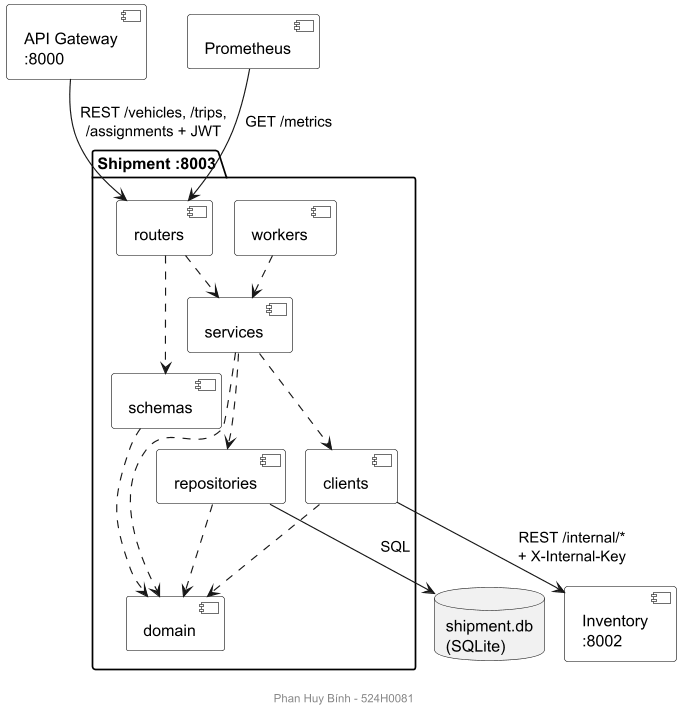
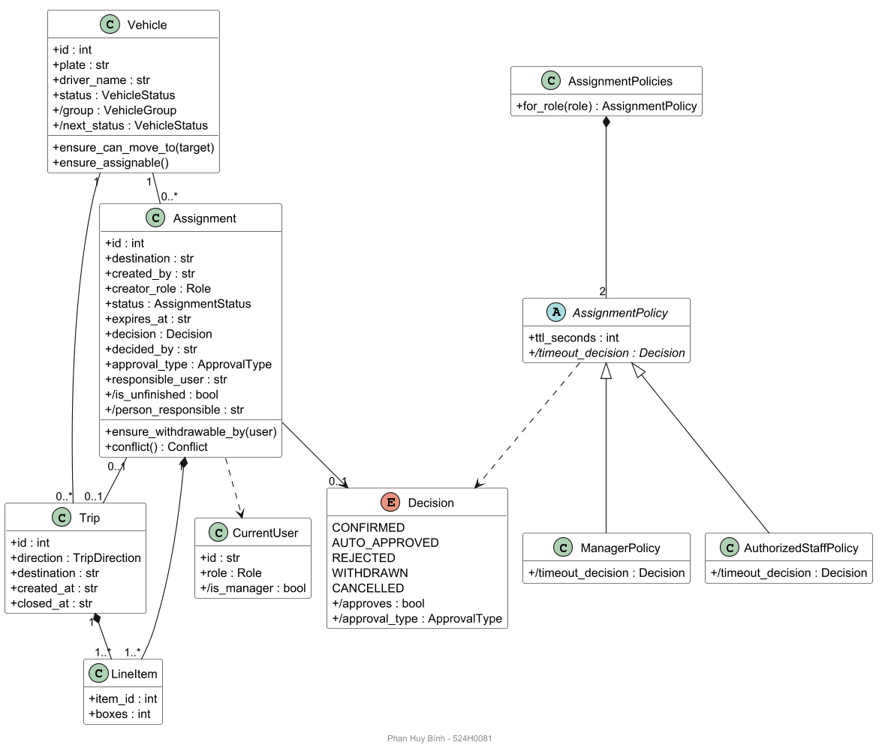
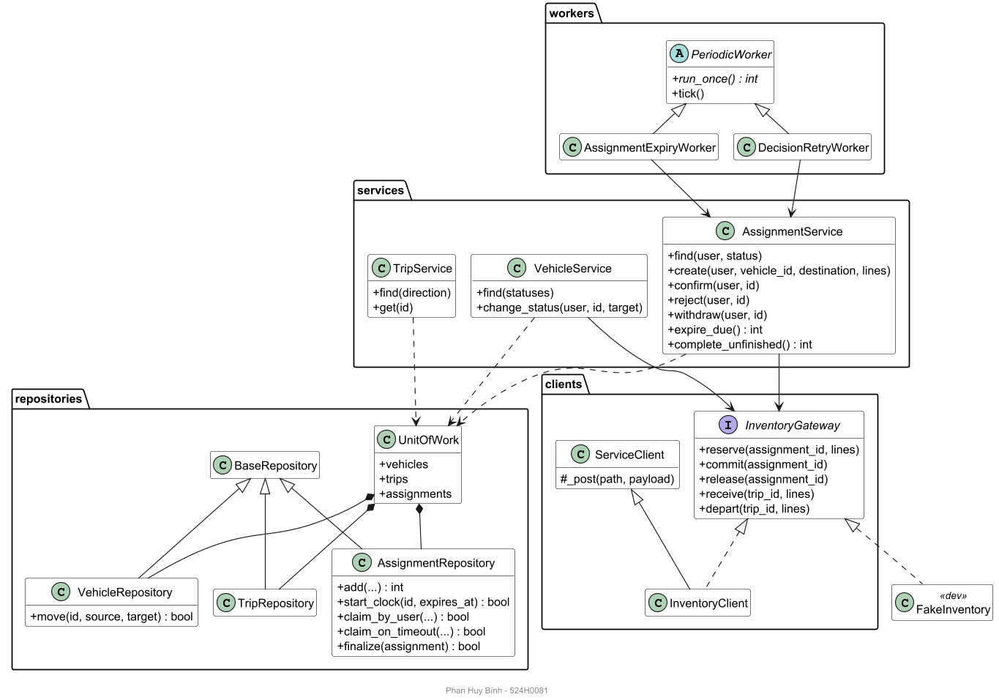

# Sơ đồ thành phần và sơ đồ lớp

Người thực hiện: Phan Huy Bính (524H0081)

## Thành phần

## Lớp domain

## Lớp nghiệp vụ và hạ tầng

| Nguyên lý OOP | Ở đâu |
|---|---|
| Đóng gói | `Vehicle`, `Assignment` tự kiểm quy tắc của mình (`ensure_can_move_to`, `ensure_withdrawable_by`); mọi SQL nằm trong repository |
| Kế thừa | `BaseRepository`, `ServiceClient`, `PeriodicWorker`, `AppError` |
| Đa hình | `AssignmentPolicy`: hạn và kết quả quá hạn khác nhau theo vai trò, `AssignmentService` không có if/else theo vai trò |
| Trừu tượng | `InventoryGateway`: nghiệp vụ không biết đang gọi REST thật hay bản giả lập |

| Mẫu thiết kế | Ở đâu |
|---|---|
| Strategy | `AssignmentPolicy` |
| Repository, Unit of Work | `repositories/` |
| Dependency Injection | `container.py` |
| Template Method | `PeriodicWorker.tick()` gọi `run_once()` của lớp con |
