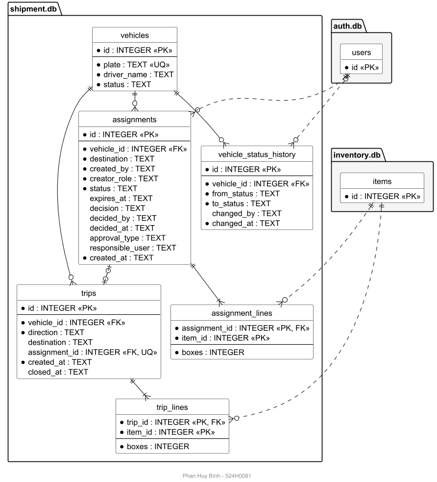

# ERD: shipment.db

Người thực hiện: Phan Huy Bính (524H0081)

Ký hiệu crow's foot: `||` đúng một, `|o` không hoặc một, `o{` không hoặc nhiều, `|{` một hoặc nhiều. Dấu chấm: bắt buộc.
Nét liền: khóa ngoại thật. Nét đứt: chỉ tham chiếu bằng ID sang CSDL của service khác, không có khóa ngoại.

| Ràng buộc trong `init.sql` | Ý nghĩa |
|---|---|
| `CHECK (status IN (...))` ở `vehicles`, `assignments` | Đúng 7 và đúng 5 trạng thái |
| `UNIQUE INDEX ... ON assignments(vehicle_id) WHERE status = 'PENDING'` | Khóa xe: tối đa một lần gán PENDING mỗi xe |
| `assignments.expires_at` | Đồng hồ duy nhất; NULL khi Inventory chưa giữ chỗ xong |
| `assignments.decision` | Ai đã giành quyền quyết định, trong lúc chờ Inventory |
| `approval_type IN ('MANUAL', 'TIMEOUT')` | Quản lý duyệt, hoặc hết hạn tự duyệt; từ chối và rút thì NULL |
| `decided_by`, `responsible_user` | Dấu vết trách nhiệm; tự duyệt: NULL và nhân viên tạo |
| `AUTOINCREMENT` ở `assignments`, `trips` | ID là khóa idempotent bên Inventory, không được dùng lại |
| `trips.closed_at IS NULL` | Lượt chưa thả xong (IN) hoặc chưa rời kho (OUT) |
| `PRIMARY KEY (trip_id, item_id)`, `boxes > 0` | Mỗi mặt hàng một dòng, đơn vị thùng |
