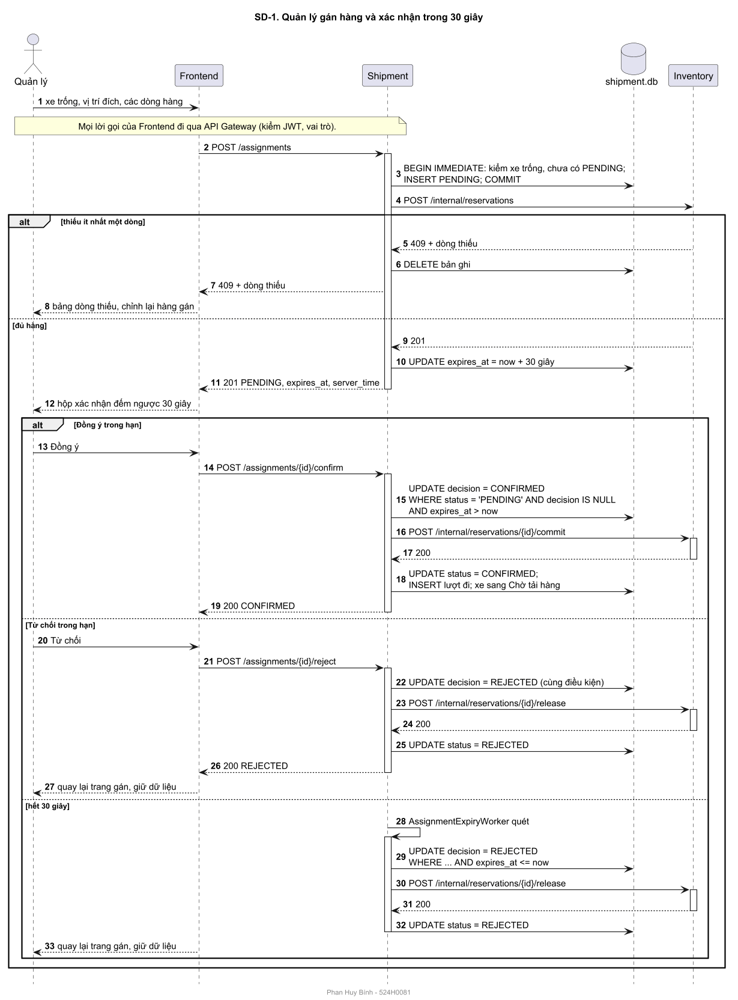
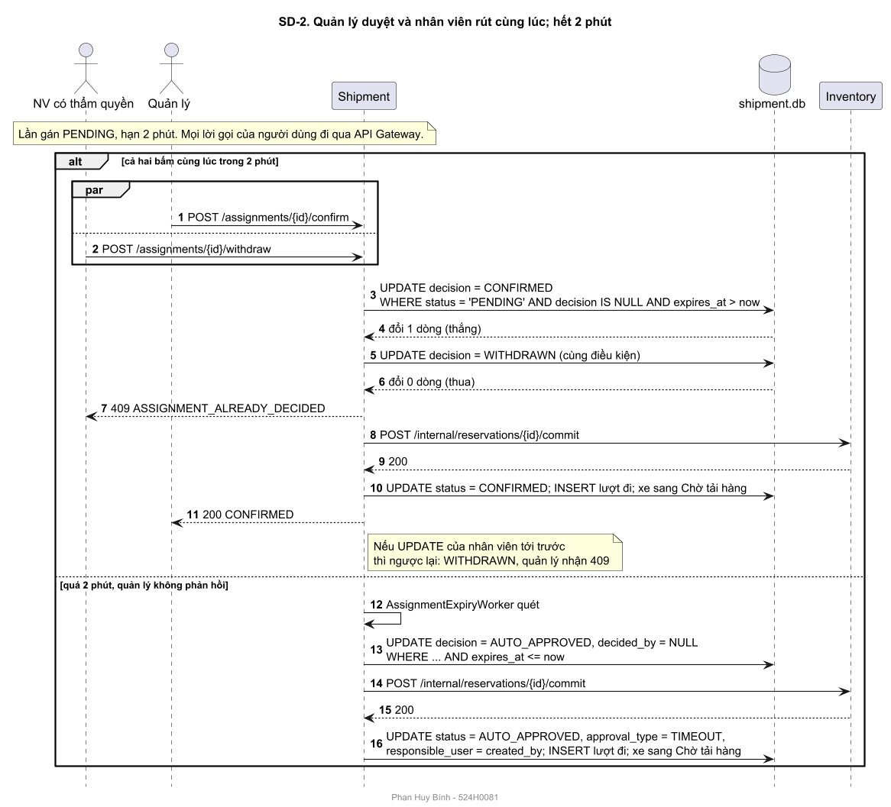
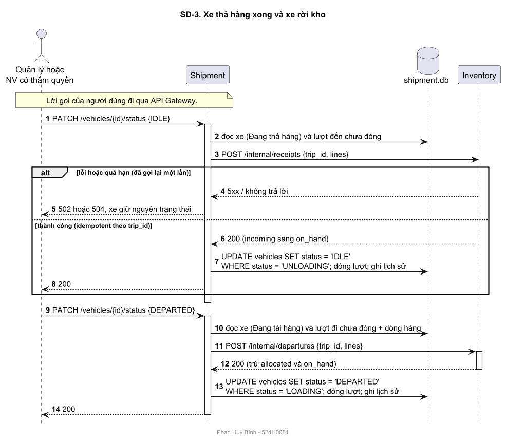
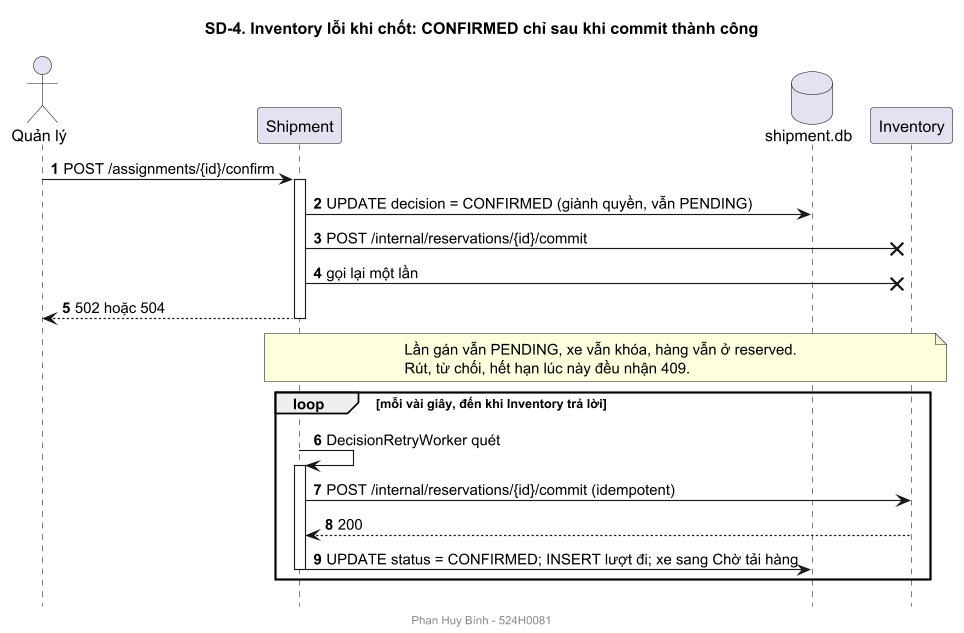
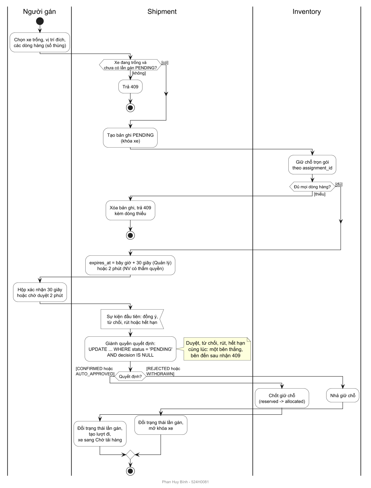

# Sơ đồ tuần tự và hoạt động

Người thực hiện: Phan Huy Bính (524H0081)

## SD-1. Quản lý gán hàng và xác nhận trong 30 giây

## SD-2. Duyệt và rút cùng lúc; hết 2 phút

## SD-3. Xe thả hàng xong và xe rời kho

## SD-4. Inventory lỗi khi chốt

## Sơ đồ hoạt động: gán hàng xuất kho

