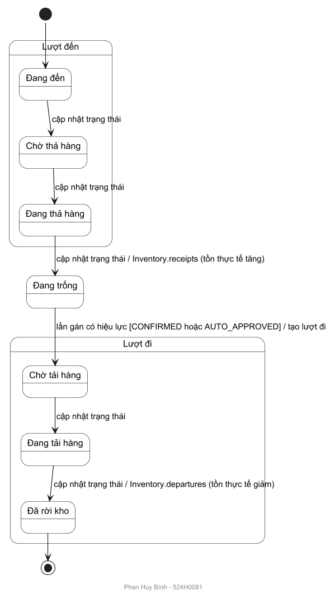
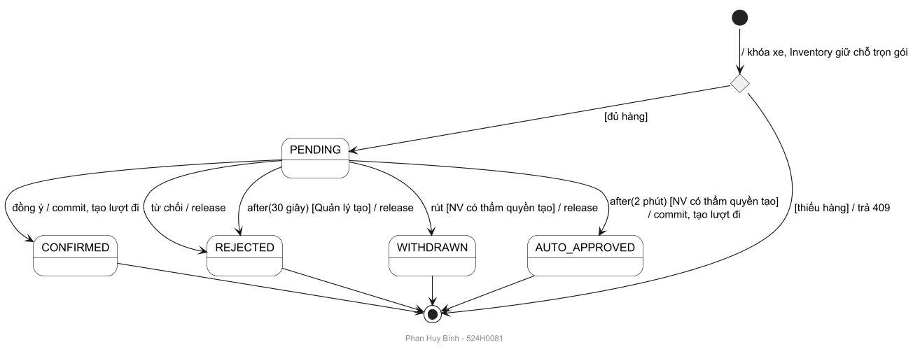

# Sơ đồ trạng thái

Người thực hiện: Phan Huy Bính (524H0081)

Nhãn theo UML: `sự kiện [điều kiện] / hành động`. `after(...)` là sự kiện thời gian.

## Xe: 7 trạng thái, 3 nhóm

Người dùng chỉ chuyển sang bước kế tiếp, sai bước thì 409. Đang trống sang Chờ tải hàng chỉ do hệ thống làm.

## Lần gán: 5 trạng thái

| Trạng thái | Người quyết định | Loại duyệt | Chịu trách nhiệm | Giữ chỗ |
|---|---|---|---|---|
| PENDING | | | | ACTIVE |
| CONFIRMED | Quản lý | MANUAL | Quản lý | COMMITTED |
| AUTO_APPROVED | (trống) | TIMEOUT | Nhân viên tạo | COMMITTED |
| REJECTED | Quản lý, hoặc trống nếu hết 30 giây | | | RELEASED |
| WITHDRAWN | Nhân viên tạo | | | RELEASED |

Bất biến: lần gán ở trạng thái cuối thì Inventory **đã** chốt hoặc nhả xong.
