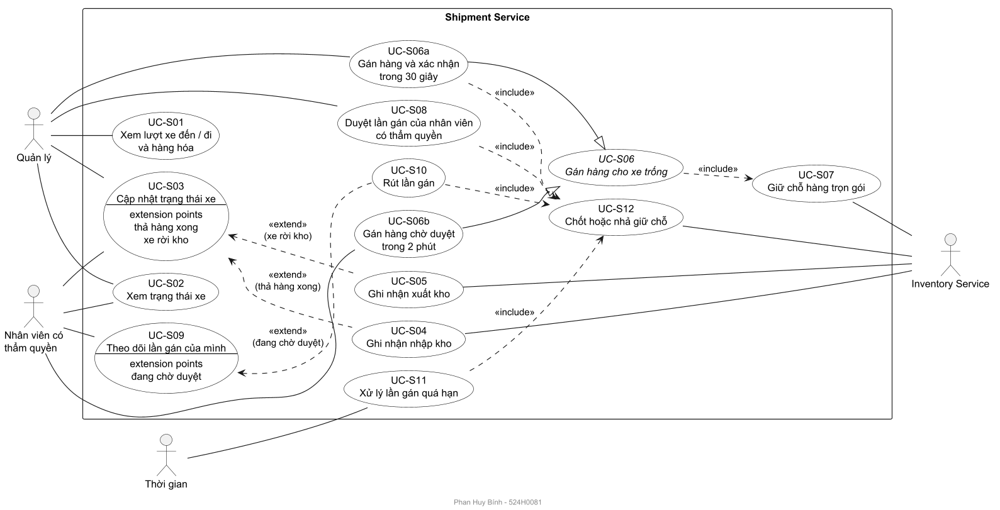

# Use Case: Shipment

Người thực hiện: Phan Huy Bính (524H0081)

- **Tác nhân chính**: Quản lý, Nhân viên có thẩm quyền, Thời gian (kích hoạt xử lý quá hạn).
- **Tác nhân phụ**: Inventory Service.
- Nhân viên thường không có use case ở Shipment (chỉ xem tồn và tạo yêu cầu xử lý).
- Tiền điều kiện chung: đã đăng nhập. Đăng nhập thuộc Auth nên không vẽ `<<include>>` ở đây.

## UC-S06a. Gán hàng và xác nhận trong 30 giây

| Mục | Nội dung |
|---|---|
| Tác nhân | Quản lý; phụ: Inventory Service |
| Tiền điều kiện | Có xe Đang trống, chưa có lần gán PENDING |
| Luồng chính | 1. Chọn xe, vị trí đích, các dòng hàng. 2. Hệ thống khóa xe, Inventory giữ chỗ trọn gói (UC-S07). 3. Hiện hộp xác nhận 30 giây. 4. Quản lý Đồng ý. 5. Inventory chốt giữ chỗ (UC-S12). 6. Lần gán CONFIRMED, tạo lượt đi, xe sang Chờ tải hàng. |
| Thay thế | 2a. Thiếu hàng: 409 kèm dòng thiếu, không tạo lần gán. 4a. Từ chối: nhả chỗ, REJECTED, quay lại trang gán. 4b. Quá 30 giây: như Từ chối. |
| Ngoại lệ | 2b. Inventory lỗi: 502 / 504, không có lần gán nào được tạo. 5a. Inventory lỗi: lần gán vẫn PENDING, hệ thống gọi lại đến khi xong. |
| Hậu điều kiện | Hàng ở allocated, có lượt đi, xe Chờ tải hàng |

## UC-S06b. Gán hàng chờ duyệt trong 2 phút

| Mục | Nội dung |
|---|---|
| Tác nhân | Nhân viên có thẩm quyền; phụ: Inventory Service |
| Luồng chính | 1 và 2 như UC-S06a. 3. Lần gán hiện trong hộp thư duyệt của Quản lý. 4. Quản lý Chấp thuận (UC-S08). 5 và 6 như UC-S06a. |
| Thay thế | 4a. Từ chối: REJECTED, nhân viên chỉnh sửa và gán lại. 4b. Nhân viên rút (UC-S10): WITHDRAWN. 4c. Quá 2 phút (UC-S11): AUTO_APPROVED, người duyệt trống, loại duyệt hết hạn, trách nhiệm thuộc nhân viên. |
| Quy tắc | Các sự kiện ở bước 4 đến cùng lúc: một bên thắng, bên sau nhận 409 |

## UC-S03. Cập nhật trạng thái xe

| Mục | Nội dung |
|---|---|
| Tác nhân | Quản lý, Nhân viên có thẩm quyền; phụ: Inventory Service |
| Luồng chính | Chọn xe, chuyển sang bước kế tiếp, ghi lịch sử |
| Mở rộng | UC-S04 khi thả hàng xong: cộng tồn thực tế. UC-S05 khi rời kho: trừ tồn thực tế. |
| Ngoại lệ | Sai bước: 409. Người khác đổi trước: 409. Inventory lỗi: 502 / 504, xe giữ nguyên trạng thái. |
